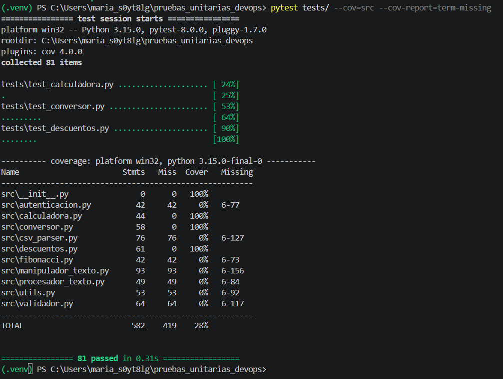

# Informe — Análisis y Mejora de Pruebas Unitarias

## 1. Datos
| Mariana Laverde |
| Grupo 1       |
| 17 de octubre de 2026 |
| Introducción a DevOps — Universidad Nacional de Colombia, Sede Manizales |

Las pruebas están en `tests/` y se ejecutan con `pytest`. Todas siguen la estructura AAA (Arrange-Act-Assert).

---

## 2. Análisis por módulo

Mi criterio general fue el mismo en los tres módulos: para cada función probé un caso normal y luego me pregunté "¿qué entrada la rompería?". Eso me llevó a probar valores en los bordes (0, 100%, listas vacías, el cero absoluto) y entradas inválidas (negativos, porcentajes fuera de rango), verificando que la función lance `ValueError` cuando corresponde.

### `calculadora.py` — operaciones matemáticas básicas
Contiene suma, resta, división, potencia, raíz cuadrada, promedio, máximo, mínimo, y área y perímetro de un rectángulo.

- Listas (`minimo`, `maximo`, `promedio`): probé listas de solo positivos, listas con negativos y listas vacías. La lista de solo positivos fue la que reveló el bug de `minimo`, porque la función partía de un valor inventado (0) en lugar de un elemento real de la lista.
- `raiz_cuadrada`: probé un positivo, el 0 (límite) y un negativo. Un negativo no tiene raíz real, así que esperaba un error y la función devolvía un número complejo sin avisar.
- `dividir`, `rectangulo`: probé los casos de error que el código ya validaba (división por cero, medidas negativas), para confirmar que esa protección funciona.

### `descuentos.py` — cálculo de precios y descuentos
Es el módulo con más lógica de negocio y son códigos muy útiles en donde un error puede perjudicar a los clientes.

- Límites del porcentaje: probé 0% y 100% exactos, y valores fuera del rango (101%, negativos).
- `descuento_por_volumen`: probé la cantidad exacta de cada escalón (10, 20, 50 y 100 unidades) y una justo debajo (9), porque los errores suelen estar en si la comparación usa `>` o `>=`.
- `calcular_precio_final`: usé números fáciles de verificar a mano (100, 20% de descuento, 10% de impuesto = 88). Así descubrí que el impuesto se calculaba sobre el precio original y no sobre el precio con descuento.
- `descuento_apilado`: probé descuentos que suman más de 100% y descuentos negativos. Ambos casos rompían la función.

### `conversor.py` — conversión de unidades (módulo elegido)
Lo elegí porque tiene muchas funciones con valores de referencia conocidos, lo que permite verificar cada conversión con datos reales.

- Valores de referencia: 100 °C = 212 °F, 32 °F = 0 °C, y −40, el único punto donde Celsius y Fahrenheit coinciden.
- Conversiones de ida y vuelta: si 1 milla = 1,60934 km, entonces 1,60934 km deben dar 1 milla. Esta prueba reveló que `kilometros_a_millas` multiplicaba en lugar de dividir.
- Cero absoluto: 0 K es válido, pero una temperatura en Kelvin menor que 0 no existe físicamente, y la función la aceptaba.
- Negativos: como 12 funciones comparten la misma regla (no aceptar distancias, pesos o volúmenes negativos), usé `@pytest.mark.parametrize` para aplicar una sola prueba a todas sin repetir código.

---

## 3. Tabla de bugs

| # | Módulo | Función | Entrada | Resultado erróneo | Resultado esperado | Corrección aplicada |
|---|---|---|---|---|---|---|
| 1 | calculadora | `minimo` | `[5, 8, 3]` | `0` | `3` | Iniciar con `min_val = lista[0]` en vez de `0` |
| 2 | calculadora | `raiz_cuadrada` | `-4` | Número complejo, sin error | `ValueError` | Validar `if numero < 0: raise ValueError` |
| 3 | descuentos | `calcular_precio_final` | `precio=100, impuesto=10, descuento=20` | `90` | `88` | Calcular el impuesto sobre `precio_con_descuento` |
| 4 | descuentos | `descuento_apilado` | `precio=100, descuentos=[60, 50]` | `ValueError` (110% no permitido) | `0` (descuento limitado a 100%) | Limitar con `min(sum(descuentos), 100)` y validar cada descuento entre 0 y 100 |
| 5 | conversor | `kelvin_a_celsius` | `-10` | `-283.15`, sin error | `ValueError` | Validar `if kelvin < 0: raise ValueError` |
| 6 | conversor | `kilometros_a_millas` | `1.60934` | `2.59` | `1.0` | Dividir entre `1.60934` en lugar de multiplicar |

**Evidencia de las pruebas en rojo:**

Descuentos — pruebas en rojo (bugs 3 y 4):


Conversor — pruebas en rojo (bugs 5 y 6):


## 4. Cobertura

Comando ejecutado:

```bash
pytest tests/ -v --cov=src --cov-report=term-missing
```

Resultado:

Pruebas en verde después de corregir los bugs:


**Reporte de cobertura:**




**Lectura de los resultados:** los tres módulos que trabajé quedaron con **100% de cobertura**: `calculadora` (44 líneas), `conversor` (58) y `descuentos` (61), por encima de la meta del 85%. Las 81 pruebas pasan. El total del proyecto sale en 28% porque los otros siete módulos no estaban en el alcance del taller y aparecen en 0%; ese número no refleja la calidad de lo probado, sino el alcance. Para llegar al 100% fue clave probar los casos de error (los `raise ValueError`), porque son las líneas que solo se ejecutan con entradas inválidas y las que más fácil se olvida probar.

---

## 5. Reflexión final

**¿Qué NO mide la cobertura?** Al terminar obtuve 100% de cobertura en los tres módulos, pero entendí que ese número solo dice que cada línea del código *se ejecutó* durante las pruebas, no que se haya verificado correctamente. Si yo hubiera escrito una prueba que llamara a `minimo([5, 8, 3])` sin ningún `assert`, la cobertura habría marcado esas líneas como cubiertas y el bug habría seguido ahí. Tampoco mide los casos que no se me ocurrieron: el bug de `descuento_apilado` solo apareció cuando pensé en qué pasaba si los descuentos sumaban más de 100%. La cobertura indica qué partes del código no se probaron, pero no garantiza que lo probado esté bien. Esa calidad depende de las preguntas que uno se hace al diseñar cada prueba.

**¿Qué aprendí?** Lo que más me sorprendió fue que el código funcionaba bien con los casos obvios y solo fallaba en los bordes: listas de solo positivos, números negativos, valores fuera de rango. Ver mi primera prueba en rojo (`assert 0 == 3`) me cambió la idea de lo que es una prueba fallida: no fue un error mío, fue un hallazgo. También aprendí a trabajar en ciclo (escribir la prueba, verla fallar, corregir y verla pasar) y a dejar ese proceso registrado en commits separados (`test:` y `fix:`). Además, configurar el entorno desde cero (instalar Python, crear el entorno virtual, el `.gitignore`) me mostró que preparar el ambiente también hace parte del trabajo.

**¿Por qué importa en DevOps?** Bugs como el del impuesto en `calcular_precio_final` parecen pequeños, pero en una tienda en línea significarían cobrarle mal a cada cliente. Las pruebas automáticas permiten detectar estos errores antes de que el código llegue a producción, y como se ejecutan con un solo comando, pueden correr cada vez que alguien hace un cambio. Esa es la base de la integración continua.